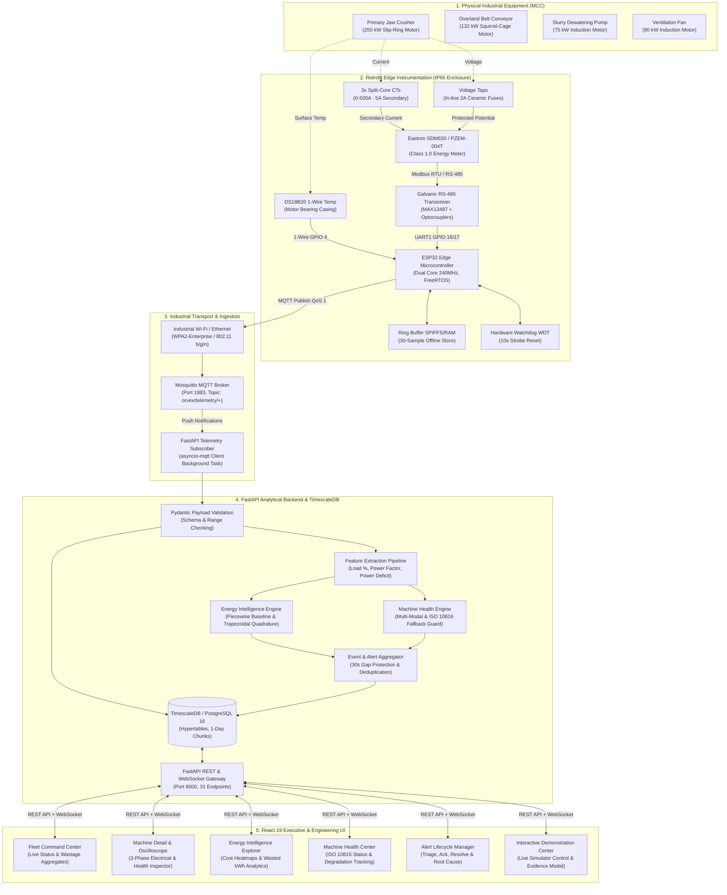
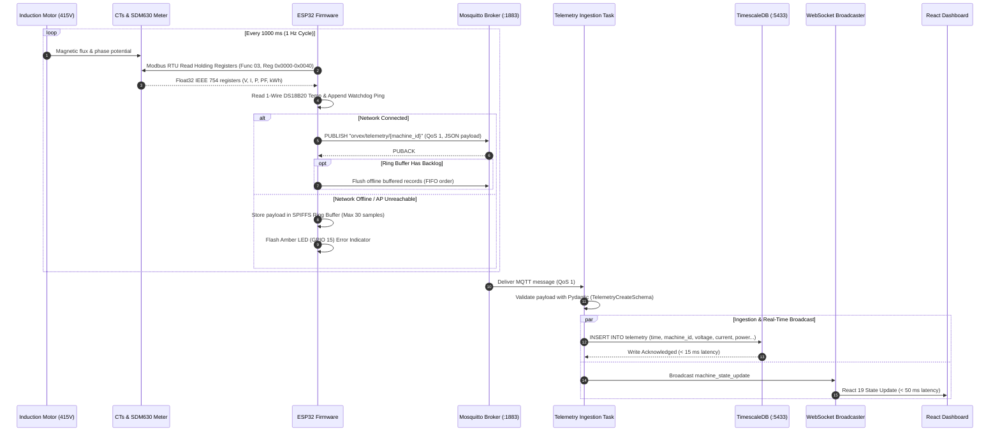
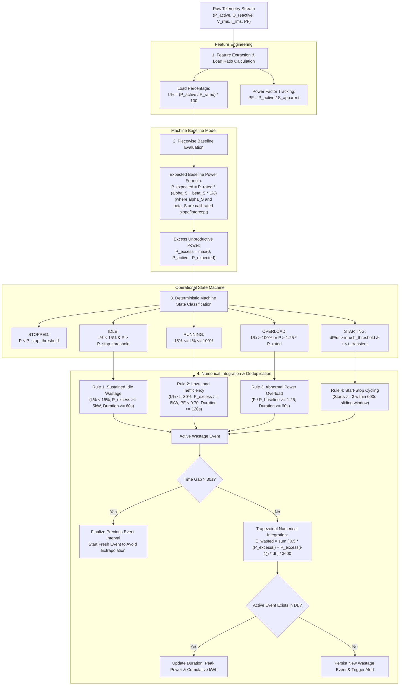
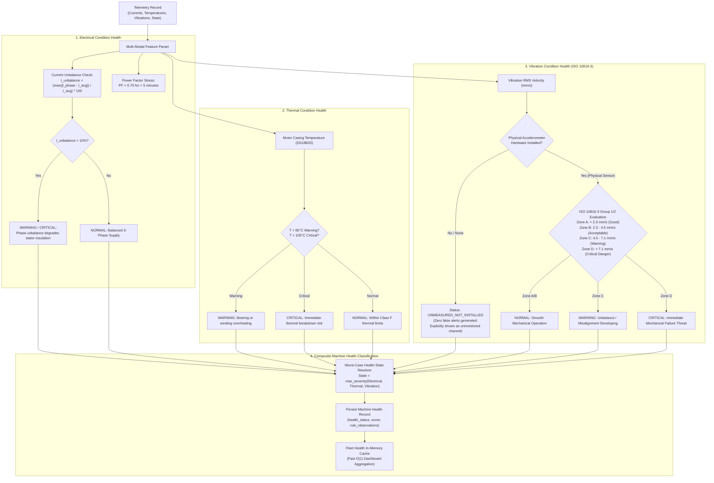
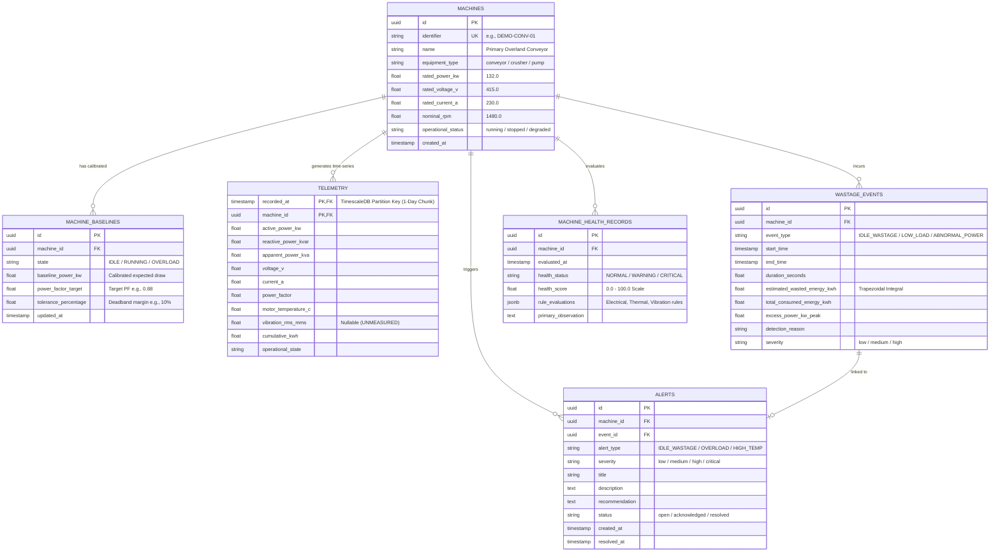
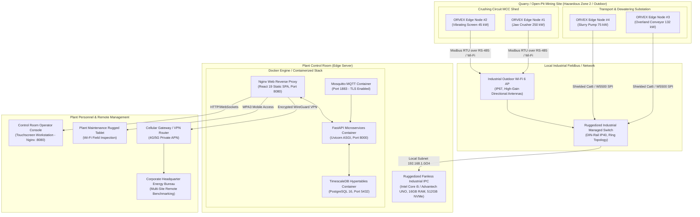

# ORVEX — Technical Architecture Diagrams
## Vishwakarma Awards 2026–27 | System Design & Dataflow Blueprints

This document provides formal, presentation-grade architecture diagrams representing the complete **ORVEX (Operational Resource & Vibration Efficiency eXplorer)** platform. Every diagram strictly reflects the implemented codebase, hardware interfaces, telemetry pipelines, and deterministic analytical engines.

---

## 1. Complete ORVEX End-to-End System Architecture

The following diagram illustrates the multi-tier architecture spanning physical assets, edge instrumentation, message transport, backend microservices, time-series persistence, and presentation layers.



---

## 2. Physical Hardware & Sensor Architecture

The hardware design focuses on **zero downtime retrofitting**, **electrical isolation**, and **personnel safety** around 415V/690V motor control centers.

```mermaid
graph LR
    subgraph MCC_Cabinet["Motor Control Center (MCC) Panel"]
        L1["Phase A (R)"]
        L2["Phase B (Y)"]
        L3["Phase C (B)"]
        N["Neutral / Ground"]
        
        CT1["Split-Core CT Phase A"]
        CT2["Split-Core CT Phase B"]
        CT3["Split-Core CT Phase C"]
        SB["CT Shorting Block\n(Safety Shunt before disconnect)"]

        F1["2A Ceramic Fuse"]
        F2["2A Ceramic Fuse"]
        F3["2A Ceramic Fuse"]
        FN["1A Neutral Fuse"]

        L1 --- CT1
        L2 --- CT2
        L3 --- CT3
        CT1 --> SB
        CT2 --> SB
        CT3 --> SB

        L1 --- F1
        L2 --- F2
        L3 --- F3
        N --- FN
    end

    subgraph SensorHub["IP66 Industrial Retrofit Enclosure"]
        SDM["Eastron SDM630 Modbus RTU\n3-Phase Power Meter (Class 1.0)\nRegisters: V, I, P, Q, S, PF, Freq, kWh"]
        PSU["Mean Well HDR-15-5\nDIN-Rail PSU (85-264VAC in -> 5VDC out)"]
        
        SB -->|Current Inputs I1, I2, I3| SDM
        F1 -->|Voltage Inputs V1| SDM
        F2 -->|Voltage Inputs V2| SDM
        F3 -->|Voltage Inputs V3| SDM
        FN -->|Voltage Neutral Vn| SDM
        F1 --> PSU
        FN --> PSU

        RS485["Galvanic Isolation Transceiver\n(MAX13487 + 2.5kV Optocouplers)\nAuto-Direction Flow Control"]
        
        SDM -->|RS-485 Differential A/B| RS485

        subgraph EdgeCompute["Edge Processing Unit"]
            ESP32["ESP32-WROOM-32D\n(Dual Xtensa 32-bit LX6 @ 240MHz)\n520 KB SRAM | 4 MB Flash"]
            DS["DS18B20 Temp Sensor\n(Motor Housing, IP68 probe)"]
            PULLUP["4.7kΩ Pull-up Resistor"]
            LEDS["Status LEDs (GPIO 2, GPIO 15)\n(Heartbeat & Modbus Activity)"]
            
            RS485 -->|UART RX (GPIO 16) / TX (GPIO 17)| ESP32
            DS -->|1-Wire Bus (GPIO 4)| ESP32
            PULLUP --- DS
            ESP32 --> LEDS
            PSU -->|5V / GND Clean Power| ESP32
        end
    end

    subgraph Network["Wireless / Industrial Bus"]
        AP["Industrial AP / Gateway\n(Mosquitto MQTT Server :1883)"]
        ESP32 -->|802.11 b/g/n Wi-Fi or W5500 SPI Ethernet| AP
    end
```

---

## 3. End-to-End Telemetry Pipeline

The telemetry pipeline delivers sub-second sampling with deterministic QoS 1 guarantees, ring-buffer fault tolerance, and TimescaleDB hypertable ingestion.



---

## 4. Energy-Intelligence Processing Pipeline

ORVEX differentiates true mechanical work from idle, low-load, and overload wastage via machine-specific piecewise power baselines and trapezoidal numerical quadrature.



---

## 5. Machine-Health Intelligence Pipeline

The health pipeline processes electrical stress, thermal limits, and mechanical vibration with a strict **unmeasured-sensor fallback guard** that prevents false negatives and false positives.



---

## 6. Backend & TimescaleDB Database Architecture

The backend leverages **PostgreSQL 16 with TimescaleDB** extensions, partitioned hypertables, and optimized service layers that eliminate write-on-read bottlenecks.



---

## 7. Industrial Production Deployment Architecture

The following diagram outlines the physical deployment in an operating quarry or mining facility, showing edge nodes, on-premise industrial gateways, and remote management consoles.



---

## 8. Summary of Architectural Integrity

Every block and interface represented in these seven diagrams corresponds directly to source artifacts in the ORVEX repository:

1. **Hardware Firmware:** `hardware/esp32/orvex_esp32_firmware.ino` (Modbus RTU, 1-Wire DS18B20, 30-sample ring buffer, 10s hardware watchdog).
2. **Gateway Transport:** `backend/app/services/telemetry_service.py` and `mosquitto.conf` (MQTT QoS 1 on topic `orvex/telemetry/{machine_id}`).
3. **Database Schema:** `backend/app/db/` and `docker-compose.yml` (TimescaleDB hypertable `telemetry` partitioned in 1-day chunks).
4. **Energy Analytics:** `backend/app/services/energy_engine.py` (Piecewise power baseline and trapezoidal numerical quadrature with 30s gap protection).
5. **Machine-Health Analytics:** `backend/app/services/machine_health_service.py` (Current unbalance, power factor, thermal limits, and `UNMEASURED_NOT_INSTALLED` vibration fallback).
6. **Frontend Dashboard:** `frontend/src/` (React 19 SPA running on Vite/Nginx with Fleet, Machine, Energy, Health, Alert, and Demonstration views).

